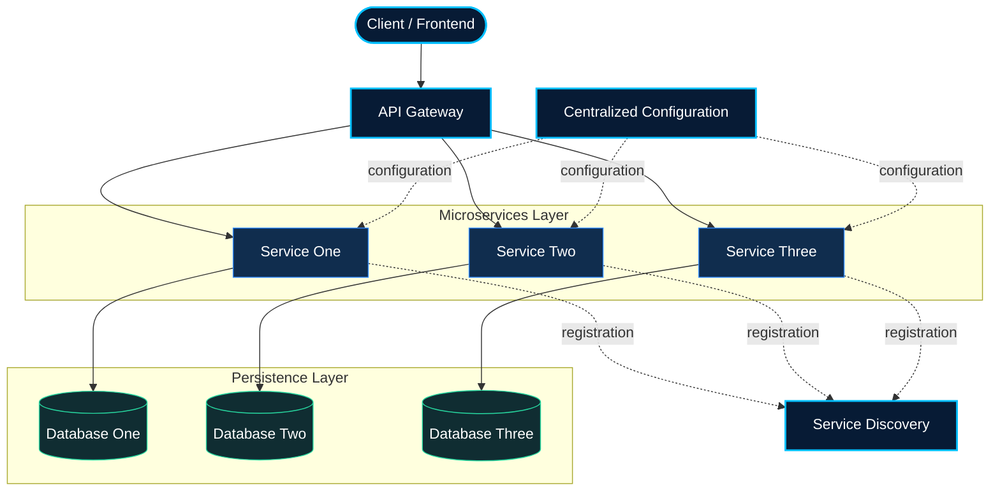

 
<div align="center">

# ⚡ SPRING BOOT 3 MICROSERVICES

### `Distributed Systems. Clean Architecture. Production-Minded Engineering.`

<p>
  
  
  
  
</p>

**A modern microservices ecosystem built with Java and Spring Boot 3.**

Designed to explore service independence, RESTful communication, distributed configuration, resilience, observability, and scalable backend architecture.

[Architecture](#-architecture) · [Tech Stack](#-technology-stack) · [Getting Started](#-getting-started) · [Roadmap](#-roadmap)

</div>

---

## ◈ Engineering Overview

Microservices aren't just about splitting a monolith into smaller applications. They're about designing independently deployable services with clear responsibilities, well-defined contracts, and reliable communication.

This repository is a hands-on implementation of those principles using the Spring ecosystem.

- **Modular by design** — separate business capabilities into independently managed services.
- **API-first communication** — expose functionality through clearly defined REST endpoints.
- **Resilience-oriented** — explore timeouts, retries, circuit breakers, and fault isolation.
- **Cloud and container aware** — prepare services for Docker-based development and deployment.
- **Built for learning** — understand the architectural decisions behind distributed applications.

## 🏗️ Architecture



> **Architecture note:** This diagram illustrates a reference design. Rename the services and remove components that aren't implemented in your repository.

## 🧩 Core Components

| Component | Responsibility |
|---|---|
| API Gateway | Central entry point for routing client requests |
| Service Discovery | Allows services to locate registered instances |
| Config Server | Centralizes externalized service configuration |
| Business Services | Encapsulate independent business capabilities |
| Persistence Layer | Stores service-owned application data |
| Resilience Layer | Handles selected downstream failures gracefully |
| Observability | Supports health checks, metrics, and diagnostics |

These components are architectural building blocks; their actual availability depends on the modules implemented in this repository.

## ⚙️ Technology Stack

<div align="center">

| Layer | Technologies |
|---|---|
| Language | Java |
| Framework | Spring Boot 3 |
| Service Communication | REST APIs, Spring Web |
| Service Management | Spring Cloud components, where configured |
| Persistence | Spring Data JPA, relational databases |
| Security | Spring Security, JWT where configured |
| Resilience | Resilience4j, where configured |
| Testing | JUnit 5, Mockito, Spring Boot Test |
| Build | Maven |
| Containerization | Docker, Docker Compose |
| Tooling | Git, Postman, IntelliJ IDEA |

</div>

## 📂 Repository Structure

```text
spring-boot-3-microservices/
│
├── api-gateway/
│   └── src/
├── service-discovery/
│   └── src/
├── config-server/
│   └── src/
├── service-one/
│   └── src/
├── service-two/
│   └── src/
├── service-three/
│   └── src/
│
├── docker-compose.yml
├── .github/
│   └── workflows/
├── docs/
│   └── architecture.md
├── postman/
│   └── collection.json
├── .gitignore
├── pom.xml
└── README.md
```

*Illustrative structure — keep only the directories and files that exist in your project.*

## 🚀 Getting Started

### Prerequisites

- Java version compatible with your Spring Boot 3.x release
- Maven or the included Maven Wrapper
- Git
- Docker and Docker Compose, if using containerized services

### 1. Clone the repository

```bash
git clone https://github.com/codemasteryash/spring-boot-3-microservices.git
cd spring-boot-3-microservices
```

### 2. Configure the environment

Configure the required database URLs, credentials, service ports, and external dependencies in the appropriate application configuration files or environment variables.

**Security tip:** Never commit database passwords, access tokens, or production secrets.

### 3. Build the project

For a Maven multi-module project:

```bash
./mvnw clean verify
```

On Windows PowerShell:

```powershell
.\mvnw.cmd clean verify
```

If the repository contains separate Maven projects, build each service from its own directory instead.

### 4. Run the services

Start the infrastructure components first, then launch the business services and gateway according to their configured ports and dependencies.

If Docker Compose is configured:

```bash
docker compose up --build
```

### 5. Verify the application

Where Spring Boot Actuator is configured, check a service's health endpoint:

```http
GET /actuator/health
```

Use the actual gateway URL and service endpoints defined by your application.

## 🔬 Engineering Principles

**Service boundaries** — each service should own a clearly defined business capability.

**Failure isolation** — a downstream service failure should not automatically take down every upstream service.

**Configuration outside code** — environment-specific values belong in configuration, not hardcoded source files.

**Independent testing** — validate business logic, API contracts, persistence behavior, and service integrations separately.

**Observability by default** — health indicators, structured logs, and meaningful metrics help diagnose distributed failures.

## 🗺️ Development Roadmap

- [ ] Document each service's responsibilities and API contracts.
- [ ] Add unit and integration tests.
- [ ] Configure centralized logging and health monitoring.
- [ ] Add resilience policies for critical inter-service calls.
- [ ] Containerize the services and supporting infrastructure.
- [ ] Add automated build and test workflows with GitHub Actions.
- [ ] Document security and environment configuration.
- [ ] Add deployment instructions and example API requests.

## 🧪 API Testing

Use Postman or another HTTP client to test the APIs.

Recommended collection structure:

```text
Microservices API Collection
├── Gateway
│   ├── Health Check
│   └── Route Validation
├── Service One
│   ├── Create Resource
│   ├── Get Resource
│   └── Update Resource
├── Service Two
│   └── Business Operations
└── Error Scenarios
    ├── Invalid Request
    ├── Resource Not Found
    └── Downstream Service Failure
```

Replace these examples with the actual endpoints provided by your services.

## 👨‍💻 About the Developer

**Yash Gupta**  
Backend Developer | Java | Spring Boot | Microservices

Focused on building maintainable backend systems, understanding distributed architecture, and developing practical software engineering skills.

<p>
  <a href="https://github.com/codemasteryash">
    
  </a>
  <a href="https://www.linkedin.com/in/yash-gupta-60317630a/">
    
  </a>
</p>

---

<div align="center">

### ⚡ BUILD SMALL. THINK DISTRIBUTED. ENGINEER FOR FAILURE.

<sub>Java • Spring Boot 3 • Microservices • Distributed Systems</sub>

</div>
